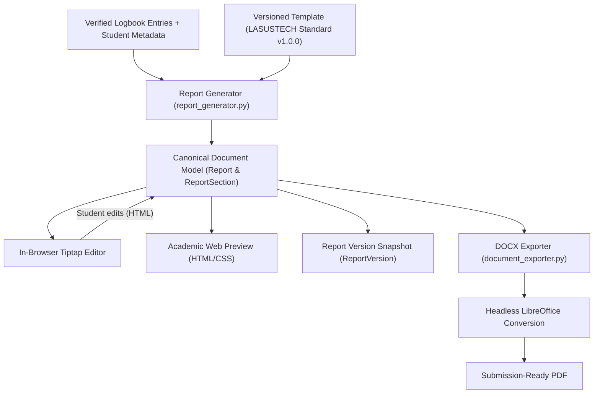

# ADR-001: Canonical Document Model and Report Rendering Pipeline

- **Status:** Accepted
- **Date:** 2026-11-04
- **Authors:** Log2Def Engineering Team (`jayo14`)
- **Applies to:** Report Generation, In-Browser Editor, Academic Preview, DOCX Exporter, PDF Exporter

---

## 1. Context and Problem Statement

Log2Def's primary outcome is to transform a student's verified SIWES logbook into a polished, editable, 12–15 page technical report conforming to LASUSTECH guidelines.

A critical risk in document generation applications is **representation divergence**:
If the in-browser interactive editor, the web preview, and the downloadable exports (DOCX / PDF) use disparate document representations (for example, generating DOCX directly from prompt text while rendering preview from Markdown or ad-hoc HTML), discrepancies inevitably emerge:
1. Formatting, bolding, lists, and tables render differently in the browser than in the exported Word document.
2. Changes made by the student in the editor may fail to map back cleanly to the export engine.
3. Pagination, headings, and chapter numbering drift, frustrating students who need a submission-ready document.

We must define **one canonical document model** (a single source of truth) from which all previews, edits, version snapshots, and export artifacts are derived, guaranteeing they can never diverge.

---

## 2. Alternatives Considered

### Alternative A: Raw Markdown String
- **Pros:** Lightweight, human-readable, easily produced by LLMs.
- **Cons:** Markdown lacks precise semantic support for academic tables, formal declaration signature blocks, supervisor stamp certifications, page breaks, and exact alignment tags (`text-align: center`). Conversion to DOCX via generic Markdown parsers often results in broken tables or stripped layout metadata.

### Alternative B: LaTeX Source Documents
- **Pros:** Excellent academic typesetting and deterministic pagination.
- **Cons:** Extremely difficult for average undergraduate students to edit in a non-code web editor. Integrating a rich WYSIWYG editor for LaTeX in mobile browsers introduces immense complexity and dependency bloat.

### Alternative C: Direct OOXML / DOCX as the Primary Model
- **Pros:** The export is a native Word file.
- **Cons:** OOXML (`.docx`) is an XML zip archive; editing it directly inside a web browser requires heavyweight client-side web word processors or server round-trips for every keystroke. It does not provide a lightweight representation for reactive web UI.

### Alternative D: Normalized Semantic HTML Model with Section Hierarchies (Chosen)
- **Concept:** The report is represented as a canonical tree: a parent `Report` model containing ordered `ReportSection` records. Each section stores its content as a clean, constrained subset of semantic HTML (`
`, `<h3>`, `<h4>`, `<ul>`, `<ol>`, `<li>`, `<table>`, `<tr>`, `<th>`, `<td>`, `<strong>`, `<em>`, `
`).
- **Pros:**
  1. Direct two-way binding with web rich-text editors (Tiptap / ProseMirror natively operates on semantic HTML without conversion loss).
  2. The web preview renders the exact HTML and CSS corresponding to LASUSTECH specifications (Times New Roman, 12pt, 1.5 line height, justified).
  3. The export engine (`SimpleHTMLDocxParser`) walks this exact semantic HTML AST and maps each tag directly to python-docx elements (paragraphs, runs, tables, borders, and alignments).
  4. Version control (`ReportVersion`) stores an exact JSON snapshot of sections at any point in time.

---

## 3. Decision

We adopt **Alternative D: Normalized Semantic HTML Model with Section Hierarchies** as Log2Def's single source of truth.

### Document Model Specifications:
1. **Model Entities**:
   - `Report`: Holds the project link, pinned `template_version`, `template_snapshot`, export file references, and estimated page count metadata.
   - `ReportSection`: An ordered block representing a discrete academic chapter or preliminary page (`cover`, `title_page`, `declaration`, `certification`, `dedication`, `acknowledgements`, `abstract`, `table_of_contents`, `ch1_*`, `ch2_*`, `ch3_*`, `ch4_*`, `ch5_*`, `references`, `appendices`).
   - `ReportVersion`: Holds an immutable JSON snapshot of all sections whenever a draft is generated, reverted, or manually snapshotted.

2. **Permitted HTML Tag Set**:
   - Headings: `<h1>`, `<h2>`, `<h3>`, `<h4>`
   - Paragraphs & Containers: `
`, `
` (with supported styles: `text-align: center`, `text-align: right`, `text-align: justify`)
   - Text Formatting: `<strong>`, `<b>`, `<em>`, `<i>`, ` `
   - Lists: `<ul>`, `<ol>`, `<li>`
   - Tables: `<table>`, `<thead>`, `<tbody>`, `<tr>`, `<th>`, `<td>` (with inline borders)

3. **Rendering & Export Pipelines**:
   - **Interactive Editing**: Tiptap outputs clean HTML matching this permitted tag set. When a student saves a section, it updates `ReportSection.content` and sets `last_edited_by_student=True`.
   - **Web Preview**: Renders `ReportSection.content` wrapped in a simulated A4 container with `@page` and academic CSS styling (Times New Roman, 12pt, 1.5 spacing, 1.5" left margin, 1.0" top/bottom/right).
   - **DOCX Generation**: Reads `ReportSection.content` sequentially. Renders preliminary pages (lowercase Roman numerals: i, ii, iii...), inserts section breaks, starts Chapter 1 on page 1 with Arabic numerals (1, 2, 3...), suppresses visible page numbers on the cover page, and creates real table of contents references.
   - **PDF Generation**: Converts the generated DOCX via headless LibreOffice, ensuring pixel-perfect layout parity between the Word and PDF deliverables.

---

## 4. Guarantees and Invariants

1. **Zero Divergence Guarantee**:
   The web editor, the web preview, and the export engine all consume the identical `ReportSection.content` HTML string. No secondary translation step exists.
2. **Template Version Immutability**:
   A generated report is pinned to `template_version` (e.g. `'lasustech-1.0.0'`) and stores a frozen `template_snapshot`. Any subsequent modifications to template definitions in the codebase or database will never alter previously generated reports.
3. **Anti-Padding and Grounding**:
   If a section lacks source material from the logbook or student details, the generator flags it as `needs_input` and appends actionable guidance rather than inventing corporate profiles, activities, or tools.
4. **Target Page Count Transparency**:
   The system calculates the estimated page length based on standardized academic formatting (~350 words per page at 1.5 spacing, plus preliminary pages and tables). If the content yields under the 12–15 page target, the system highlights this to the student and provides specific recommendations on which chapters to expand.

---

## 5. Status & Next Steps

This architecture is implemented across `backend/api/report_generator.py`, `backend/api/document_exporter.py`, and the frontend dashboard.

## Template v2 migration decision (2026-11-05)

The original pipeline is `api/report_generator.py` → persisted `ReportSection.content` HTML → `api/document_exporter.py` DOCX parsing → LibreOffice PDF conversion. V1 is a five chapter structure and its chapter headings and sample TOC are repeated in the exporter. V1 reports retain their pinned template snapshot.

The v2 coordinator structure is versioned as `lasustech_cs:2.0.0` in `backend/api/templates/lasustech_cs_v2.json`. Its input manifest and unresolved confirmation flags live in the same file. `Report.document_model` stores typed sections and provenance, generation snapshots that tree, and DOCX export consumes it. PDF conversion uses the DOCX output. For legacy reports without a stored tree, export derives a temporary tree from the pinned snapshot and stored sections.

The editor and preview still use `ReportSection` records, and new report creation still routes through the v1 generator. The document model is not yet the complete application single source of truth, and the coordinator template is defined but not yet activated for new reports. Completing that integration requires a v2 intake/generator and preview/editor migration.

Known unresolved v2 fields marked `NEEDS_CONFIRMATION`: college field policy; abstract OFF default; TOC ON default; cover numbering ON; department margins are unknown so 2.54 cm all round is provisional; reference editions and the existence of LASUSTECH guidelines require verification. The date format is configurable.
