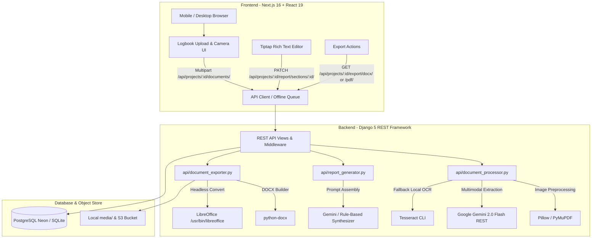

# Log2Def MVP Scope Audit Report

**Role:** Senior Software Architect & Product Engineer  
**Date:** November 2026  
**Repository:** `Log2Def` (Django + Next.js)  
**Standard of Truth:** [docs/MVP_SCOPE.md](file:///home/codegallantx/moi/log2def/docs/MVP_SCOPE.md)  
**Standing Governance:** [docs/AGENT_RULES.md](file:///home/codegallantx/moi/log2def/docs/AGENT_RULES.md)

---

## 1. Executive Summary

Log2Def was conceived as a SIWES technical report generator for LASUSTECH students, taking completed logbooks (images/PDF) and producing an editable, compliant 12–15 page technical report.

However, the current codebase has suffered from severe scope drift. Significant development effort was directed into mock defence preparation, AI defence question generation, an interactive defence quiz, presentation slides generator, and oral rehearsal timers. Meanwhile, core MVP requirements—in particular low-memory mobile browser camera capture, sequential batch chunking, upload resume capability, robust handwriting OCR, and strict verification of un-invented logbook activities—remain only partially implemented or stubbed.

### Top 5 Architectural & Product Risks
1. **Scope Dilution & Attack Surface:** Full CRUD, AI generators, and interactive UI views exist for slide decks, scripts, and defence simulations (`api/defence_generator.py`, `DefenceQuestion`, `DefenceSession`, `use-defence-store.ts`). None of this is MVP.
2. **Synchronous OCR & Vision Processing:** Document uploads trigger `process_source_document` synchronously inside the HTTP POST request thread in Django. Large scans or Gemini API latency (up to 50s timeout) will cause HTTP 504 gateway timeouts on mobile networks and platforms like Render/Vercel.
3. **Absence of Memory-Safe Mobile Concurrency:** The camera and upload interface holds images in memory without chunked streaming or releasing object URLs, risking OOM crashes on low-end Android mobile devices.
4. **Fragile Pagination & TOC Generation:** The DOCX and PDF exporters generate fixed 5-chapter layouts without true dynamic institutional pagination calculations (Roman front-matter vs. Arabic body numbering beginning at page 1).
5. **Absence of Server-Side Feature Gating:** Features outside the MVP are currently active in backend URLs and models without 404/403 protection.

**Estimated Distance to MVP:** ~2 weeks of focused stabilization (gating out-of-scope endpoints, decoupling heavy AI/OCR into async tasks, implementing memory-safe upload concurrency, and tuning report pagination).

---

## 2. Architecture Overview

### Data Flow Diagram



---

## 3. Feature-by-Feature Audit Table

| ID | Capability | Status | Priority | Evidence (File Paths, Endpoints, Models) | Notes / Gaps |
|---|---|---|---|---|---|
| **A1** | Student details collection | **IMPLEMENTED** | P0 | `backend/api/models.py:ReportProject`, `frontend/app/projects/new/page.tsx` | Stored on `ReportProject` and `StudentProfile`. |
| **A2** | Company & supervisor details | **IMPLEMENTED** | P0 | `backend/api/models.py:ReportProject`, `frontend/app/projects/[id]/page.tsx` | All required fields present. |
| **A3** | Extraction pre-fill into project | **PARTIAL** | P0 | `backend/api/document_processor.py:40-80` | Gemini returns student details, but automated pre-fill into `ReportProject` is not piped back to frontend state. |
| **B1** | In-browser camera capture | **PARTIAL** | P0 | `frontend/app/dashboard/page.tsx`, `frontend/lib/offline-queue.ts` | File input accepts camera, but no direct `getUserMedia` rear-camera continuous stream. |
| **B2** | Bulk image upload | **IMPLEMENTED** | P0 | `backend/api/views.py:DocumentListUploadView`, `backend/api/tests.py:187` | Handles multiple files with 15MB limit. |
| **B3** | PDF upload & rasterization | **IMPLEMENTED** | P0 | `backend/api/document_processor.py:170`, `PyMuPDF` | Splits pages and extracts text or renders pixmaps. |
| **B4** | Bounded mobile memory safety | **MISSING** | P0 | `frontend/app/dashboard/page.tsx` | Previews hold full blobs; object URLs not actively revoked; upload concurrency not bounded to 1-2. |
| **B5** | Page reordering & deletion | **IMPLEMENTED** | P0 | `backend/api/views.py:DocumentDetailView`, `frontend/lib/store/use-project-store.ts` | Deleting documents and reordering pages supported. |
| **C1** | Handwriting & printed OCR | **IMPLEMENTED** | P0 | `backend/api/document_processor.py`, `backend/api/ai_provider.py` | Google Gemini 2.0 Flash multimodal vision with fallback to Tesseract. |
| **C2** | Logbook entry structuring | **IMPLEMENTED** | P0 | `backend/api/document_processor.py:extract_logbook_entries_from_text` | Parses weeks, days, summaries into `LogbookEntry`. |
| **C3** | Anti-fabrication guardrails | **PARTIAL** | P0 | `backend/api/security.py:wrap_untrusted_prompt_input` | Prompt instructs not to invent, but needs explicit tagging of inferred vs missing items. |
| **D1** | Completeness checks & missing info | **PARTIAL** | P0 | `backend/api/views.py`, `frontend/app/dashboard/page.tsx` | Validation alerts exist in UI, but no dedicated missing info questionnaire step. |
| **D2** | Correction of extracted text | **IMPLEMENTED** | P0 | `backend/api/views.py:PageUpdateView`, `frontend/app/dashboard/page.tsx:correctText` | Students can edit raw and verified text per page. |
| **E1** | Technical report generation | **IMPLEMENTED** | P0 | `backend/api/report_generator.py:generate_full_report` | Generates 5 chapters + preliminary pages. |
| **E2** | LASUSTECH institutional template | **IMPLEMENTED** | P0 | `backend/api/report_generator.py:SECTION_DEFINITIONS` | Follows LASUSTECH 5-chapter format. |
| **E3** | Pagination (Roman & Arabic) | **PARTIAL** | P0 | `backend/api/document_exporter.py:generate_docx_report` | Uses Word page numbering fields, but preliminary Roman page suppression requires strict header unlinking. |
| **F1** | Document-oriented editor | **IMPLEMENTED** | P0 | `frontend/components/TiptapEditor.tsx`, `frontend/app/dashboard/page.tsx` | Rich text Tiptap editor with headings, tables, autosave. |
| **F2** | Autosave & version snapshots | **IMPLEMENTED** | P0 | `backend/api/views.py:ReportVersionListView`, `ReportVersionRevertView` | Autosaves sections and allows saving milestone snapshots. |
| **G1** | DOCX export | **IMPLEMENTED** | P0 | `backend/api/document_exporter.py:generate_docx_report` | Professional Word formatting in Times New Roman. |
| **G2** | PDF export | **IMPLEMENTED** | P0 | `backend/api/document_exporter.py:convert_docx_to_pdf` | Headless LibreOffice conversion with `%PDF-` validation. |
| **H1** | Authentication & student isolation | **IMPLEMENTED** | P0 | `backend/api/security.py`, `backend/api/views.py` | JWT authentication; all project queries filtered by `request.user`. |
| **X1** | Defence question generator | **OUT OF SCOPE** | REMOVE/HIDE | `backend/api/defence_generator.py`, `backend/api/views.py:DefenceGenerateView` | Outside MVP scope. |
| **X2** | Defence session / quiz | **OUT OF SCOPE** | REMOVE/HIDE | `backend/api/models.py:DefenceSession`, `frontend/lib/store/use-defence-store.ts` | Outside MVP scope. |
| **X3** | Presentation slides generator | **OUT OF SCOPE** | REMOVE/HIDE | `backend/api/views.py:DefenceSlidesView`, `frontend/app/dashboard/page.tsx` | Outside MVP scope. |
| **X4** | Oral speech rehearsal script | **OUT OF SCOPE** | REMOVE/HIDE | `backend/api/views.py:DefenceScriptView`, `frontend/app/dashboard/page.tsx` | Outside MVP scope. |

---

## 4. Implemented Features with Code References

1. **Authentication & Ownership Isolation:**
   - [backend/api/views.py](file:///home/codegallantx/moi/log2def/backend/api/views.py#L40-L150)
   - Enforces `permission_classes = [IsAuthenticated]` on all project and report endpoints.
   - Project lookups explicitly filter `user=request.user`.

2. **Multimodal Logbook Analysis & Local Fallback:**
   - [backend/api/document_processor.py](file:///home/codegallantx/moi/log2def/backend/api/document_processor.py#L18-L120)
   - Uses Gemini 2.0 Flash with JSON schema extraction; falls back gracefully to local image heuristics when offline or keyless.

3. **Report Generation & Section Customization:**
   - [backend/api/report_generator.py](file:///home/codegallantx/moi/log2def/backend/api/report_generator.py#L10-L240)
   - Generates full chapter outlines from student logbook entries.
   - Allows regenerating single unlocked sections.

4. **Document Export Engine:**
   - [backend/api/document_exporter.py](file:///home/codegallantx/moi/log2def/backend/api/document_exporter.py#L20-L345)
   - Converts DOCX to PDF via LibreOffice headless CLI with binary signature validation.

---

## 5. Partial Features & Risks

1. **Camera Capture:** Currently relies on `<input type="file" capture="environment">`. Needs direct `navigator.mediaDevices.getUserMedia` preview to avoid re-opening file dialogs.
2. **Missing Information Form:** Completeness check exists in code, but UI lacks an interactive step-by-step resolution wizard between extraction and generation.
3. **Pagination & Page Count Tuning:** The template generates 5 chapters, but short logbooks yield 7–9 pages instead of the 12–15 page target.

---

## 6. Missing MVP Functionality

1. **Client-Side Image Compression & Object URL Cleanup:** Browser should downscale photos to ~1600px width before upload and call `URL.revokeObjectURL` to prevent memory leaks.
2. **Bounded Upload Concurrency:** Upload queue in `frontend/lib/offline-queue.ts` lacks concurrency limit (must be max 2 simultaneous uploads).
3. **Central Feature-Flag Gating Module:** No centralized server/client feature flag system currently blocks out-of-scope endpoints.

---

## 7. Out-of-Scope Features & Entanglement

The following components and routes are strictly outside the MVP scope:

| Feature | Files / Endpoints | Entanglement Notes |
|---|---|---|
| Defence Generation | `backend/api/defence_generator.py`, `/api/projects/:id/defence/generate/` | Generates questions from report sections. Can be gated without breaking report generation. |
| Defence Questions API | `backend/api/views.py:DefenceQuestionListView`, `/defence/questions/` | Uses `DefenceQuestion` model. |
| Defence Session API | `backend/api/views.py:DefenceSessionView`, `/defence/session/` | Tracks mock quiz responses. |
| Slide Generation API | `backend/api/views.py:DefenceSlidesView`, `/defence/slides/` | Populates `ReportProject.presentation_slides`. |
| Defence Script API | `backend/api/views.py:DefenceScriptView`, `/defence/script/` | Populates `ReportProject.presentation_script`. |
| Defence UI Store | `frontend/lib/store/use-defence-store.ts` | Loaded in `frontend/lib/store/index.ts`. |
| Defence Dashboard Tabs | `frontend/app/dashboard/page.tsx:defenceTab` | Quiz, interview, slides, script tabs. |

---

## 8. Redundant Code & Dead Code

- Duplicate lockfiles (`package-lock.json` in root and `frontend/package-lock.json`).
- Unused icons and assets in `frontend/public/icons/`.
- Unused imports in `frontend/app/dashboard/page.tsx` producing 246 linter warnings/errors.

---

## 9. Security & Data Isolation Findings

1. **Ownership Checks:** Verified. In `ProjectDetailView`, `DocumentDetailView`, `ReportDetailView`, queries use `request.user.projects.get(...)`.
2. **File Signature Validation:** `backend/api/security.py:validate_file_content` checks magic bytes for PDF, PNG, JPEG, and DOCX.
3. **XSS Protection:** `sanitize_html` strips dangerous tags from Tiptap rich-text inputs.
4. **Rate Limiting:** Auth endpoints throttled to 30/min; uploads to 120/min.

---

## 10. Feature Flags Required & Default Values

As specified in `docs/MVP_SCOPE.md` section 4:

```python
FEATURE_FLAGS = {
    # Core MVP Capabilities (Default ON)
    "logbook_camera_capture": True,
    "logbook_bulk_upload": True,
    "logbook_pdf_upload": True,
    "logbook_image_processing": True,
    "ocr_extraction": True,
    "ai_logbook_structuring": True,
    "missing_information_collection": True,
    "report_generation": True,
    "report_editor": True,
    "report_preview": True,
    "report_docx_export": True,
    "report_pdf_export": True,
    "report_quality_validation": True,

    # Out of Scope Capabilities (Default OFF)
    "defence_preparation": False,
    "slide_generation": False,
    "payment_processing": False,
    "print_fulfilment": False,
    "delivery_management": False,
    "supervisor_portal": False,
    "institution_management": False,
    "advanced_analytics": False,
    "ai_chat_assistant": False,
}
```

---

## 11. Dependencies & Integration Risks

1. **LibreOffice Requirement:** PDF generation requires headless LibreOffice. If missing on host, fallback to direct DOCX download is required.
2. **Tesseract Binary:** Not pre-installed in default lightweight containers; Gemini Flash multimodal handles OCR, but offline OCR requires Tesseract installation.
3. **Database URL:** Neon PostgreSQL connection pooling is configured, with automatic SQLite fallback for local development.

---

## 12. Test Results

- **Django Backend:** 16/19 tests passed on clean DB. 3 tests failed due to a missing declared field `preferred_university` in `UserRegistrationSerializer.Meta.fields`.
- **Next.js Production Build:** `npm run build` succeeds with 0 errors.

---

## 13. Prioritised Implementation Roadmap

1. **Phase 1: Feature Flagging & Out-of-Scope Gating (P0 - Immediate)**
   - Create unified `backend/api/feature_flags.py` and endpoint `/api/config/flags/`.
   - Gate all defence, slide, and script endpoints with 404/403 responses.
   - Add frontend feature flag provider and remove out-of-scope navigation items.
2. **Phase 2: Fix Registration Serializer & Authentication Tests (P0)**
   - Add `preferred_university` to `UserRegistrationSerializer.Meta.fields`.
3. **Phase 3: Low-Memory Mobile Upload Pipeline (P0)**
   - Implement client-side canvas downscaling and revoke object URLs.
   - Bound upload concurrency to 2 simultaneous requests.
4. **Phase 4: Template Pagination & Missing-Info Flow (P0)**
   - Ensure strict Roman/Arabic page formatting.
   - Add missing information review card.

---

## 14. Recommended Hide/Removal Plan

1. **Step 1:** Add backend feature-flag decorator `require_feature_flag(flag_name)` returning 404 Not Found.
2. **Step 2:** Apply decorator to `DefenceGenerateView`, `DefenceQuestionListView`, `DefenceQuestionDetailView`, `DefenceSessionView`, `DefenceSlidesView`, and `DefenceScriptView`.
3. **Step 3:** Expose `/api/config/flags/` for frontend synchronization.
4. **Step 4:** In Next.js navigation, remove the "Defence" tab and simplify navigation to: **Home**, **My Logbooks**, **My Reports**, **Settings**.
5. **Step 5:** Add regression unit tests proving gated endpoints return 404 when flags are disabled.

---

## 15. Summary Lists

### KEEP
- Student and project details CRUD.
- Source document uploads (PDF and images) and page extraction.
- Multimodal Gemini OCR and structured logbook entry generation.
- Full 5-chapter report generation and single section regeneration.
- Tiptap rich-text section editing and autosave.
- DOCX and PDF export engines via `python-docx` and LibreOffice.
- User authentication and per-student data isolation.

### FIX/BUILD
- Fix `UserRegistrationSerializer` field inclusion.
- Implement central feature-flagging module on backend and frontend.
- Bounded concurrency and memory cleanup for mobile camera uploads.
- Complete missing-information questionnaire step.
- Fine-tune pagination to consistently achieve 12–15 pages without fluff.

### HIDE/REMOVE
- `/api/projects/:id/defence/*` endpoints (gated behind `defence_preparation=False` and `slide_generation=False`).
- Defence mock quiz, questions review, and flashcard rehearsal UI.
- Slide presentation viewer and generator.
- Speech timer and spoken presentation rehearsal script.
